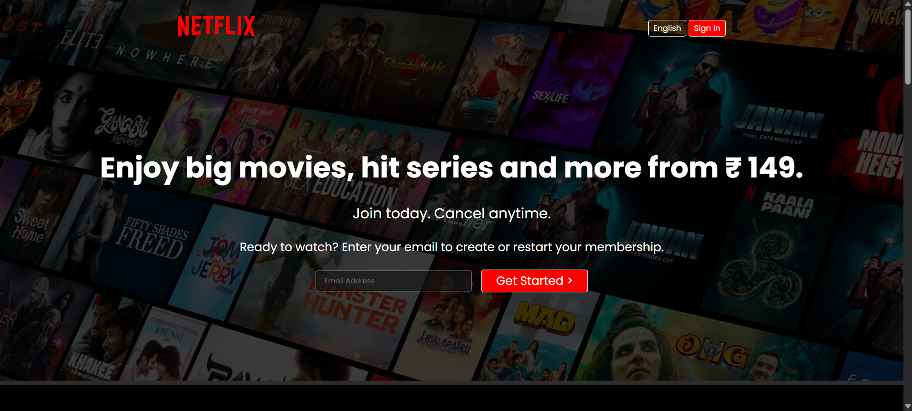

# Streaming Service UI Demo


An independent, responsive streaming-service interface built with **HTML5** and **CSS3** for front-end learning and practice.

This project focuses on responsive layouts, visual hierarchy, Flexbox, CSS Grid, spacing, typography, media queries, and reusable styling patterns.

> **Important:** This is an independent educational UI project inspired by modern streaming-service layouts. It is not affiliated with Netflix and does not represent Netflix or any other streaming company.

> This project is a static front-end demo only. It does not provide login, signup, streaming, account, payment, subscription, or membership functionality. It does not collect, store, or transmit personal information.

---

## Live Preview

[View Live Demo](https://naitik595.github.io/Netflix-Landing-Page-Clone/)

---

## Preview



---

## Features

- Responsive landing-page layout
- Dark streaming-service inspired visual design
- Hero section with background imagery
- Multiple content sections
- Device-focused layout sections
- FAQ-style interface
- Responsive footer layout
- Mobile and tablet support
- Pure HTML and CSS implementation
- No backend or data submission
- No login, signup, payment, or account functionality

---

## Built With

- HTML5
- CSS3
- Flexbox
- CSS Grid
- Media queries
- CSS transitions
- Google Fonts

---

## Project Structure

```text
Netflix-Landing-Page-Clone/
├── assets/
│   ├── images/
│   │   ├── bg.jpg
│   │   └── logo.svg
│   └── screenshots/
│       └── hero.png
├── googleaeb6ba4aceb3487f.html
├── README.md
├── index.html
└── style.css